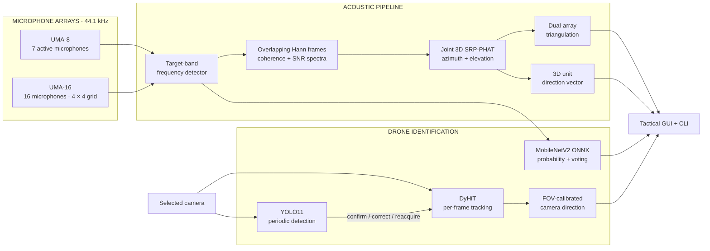

# FREQUENCY ID

### Multimodal Drone Detection, Acoustic Localization & 3D Sound Direction

Real-time drone awareness using microphone arrays, MobileNetV2 audio classification,
and YOLO camera detection—presented together in a tactical GUI and a headless CLI.


---

## Why Frequency ID?

| Capability | What it provides |
|---|---|
| **Frequency detection** | Narrowband FFT detection inside a configurable target band |
| **Acoustic direction** | Frequency-gated, multi-frame SRP-PHAT with fresh temporal confidence tracking |
| **3D sound direction** | Joint azimuth/elevation estimation and a clear 3D unit-vector arrow |
| **2D localization** | Weighted bearing-ray intersection for dual-array position and range |
| **Audio identification** | MobileNetV2 ONNX drone probability with temporal voting |
| **Camera identification** | Selectable-camera YOLO detection with boxes, confidence, and direction |
| **Visual tracking** | Per-frame DyHiT target following with asynchronous YOLO correction and reacquisition |
| **Operator interface** | Tactical map, live spectrum, camera preview, 3D direction, and organized settings |

Audio and vision remain **independent evidence channels**. Camera detection does not
invent acoustic coordinates, and acoustic tracking continues if the camera is unavailable.

## Processing Pipeline



## Hardware

- **Front / Apex:** miniDSP UMA-8, seven active microphones, facing rig forward (`0°`).
- **Left flank:** miniDSP UMA-16 v2, 16 microphones on a 42 mm grid, facing left (`270°`).
- **Board separation:** 36.5 cm between XMOS boards.
- **Camera:** any OpenCV-compatible camera selected by the operator.

```text
                         UMA-8 APEX
                         Forward · 0°
                              /
                             /  36.5 cm
                            /
                  UMA-16 LEFT
                  Left · 270°
                  Black USB cable
```

The measured separation refers to the XMOS boards. The configurable
`mic_center_offset_local_m` translates the UMA-16 board reference to its acoustic
center and currently defaults to zero until physically measured.

Both arrays use vertical mounting. For a vertical array, `orientation_deg` is the
outward face normal, local `+90°` is the viewer's right, and azimuth scans are limited
to ±90° around that normal because of front/back ambiguity. Weak UMA-16 channels can
be excluded with `active_channels`.

`RigGeometry` is the single source of microphone coordinates/heights, channel delays,
phase response, and sound speed for the shared DOA factory used by the CLI, GUI, and
simulation. Non-null `temperature_c` determines sound speed instead of the configured
`sound_speed`; the effective value is logged. Delay and phase calibration default to
zero/disabled until measured—no hardware correction values are invented.

## Quick Start

### 1. Install dependencies

Install the package in editable mode with the extras you need:

```bash
# Core + vision + PX4 control + simulation + dev tools
python3 -m pip install -e ".[vision,control,sim,dev]"

# Or install core + full legacy requirements list
python3 -m pip install -r requirements.txt
```

This installs the `frequency-id`, `frequency-id-px4`, and `frequency-id-jetson` console commands alongside the backwards-compatible root shims (`main.py`, `px4_controller.py`, `jetson_ctl.py`). On first run, `rig_config.json` is automatically bootstrapped from `config/rig_config.example.json` if not yet present.

Tkinter is supplied by the system Python. On Debian/Ubuntu, if it is missing:

```bash
sudo apt install python3-tk
```

### 2. Check connected hardware

```bash
python3 main.py list-devices
python3 main.py list-cameras
```

Enter the displayed microphone IDs in **Settings → Audio & Detection**. Select the
camera in **Settings → Camera**; no camera index is permanently assumed.

### 3. Launch

```bash
# Full tactical GUI
python3 main.py gui

# GUI with simulated acoustic input
python3 main.py gui --simulate

# Headless terminal tracker
python3 main.py cli --low 900 --high 1100 --threshold -65
```

## Operating Modes

| Mode | GUI command | Output |
|---|---|---|
| **Dual array** | `python3 main.py gui` | Bearing, X/Y position, range, and audio classification |
| **UMA-8 only** | `python3 main.py gui --uma8-only` | Direction only |
| **UMA-16 only** | `python3 main.py gui --uma16-only` | Azimuth and elevation; 3D direction arrow |
| **UMA-16 front only** | `python3 main.py gui --uma16-front-only` | Forward-mounted 3D direction using the UMA-16 device ID |
| **Simulation** | Add `--simulate` | Synthetic acoustic input without microphone hardware |

Elevation-capable arrays derive azimuth and elevation from the same joint 3D
SRP-PHAT peak using full local microphone coordinates. Flat arrays retain a 2D search
because elevation is unobservable. The estimator averages auto/cross spectra over
2048-sample Hann frames with 50% overlap, derives bin quality from inter-microphone
coherence and saturating SNR, caps individual bin weights, and refines the steering
frequency of a dominant narrowband tone between FFT bins. No triangulation, source
distance, source height, coordinates, or fixed Z value is used.

The 3D arrow points **toward the sound source**. Positive elevation means above the
array; negative elevation means below. If the vertical estimate lacks prominence or
temporal consistency, the interface reports **ELEVATION UNCERTAIN** and draws no arrow
instead of assuming the source is level.

Azimuth and elevation stability require a fresh, acceptable current measurement.
Capture timestamps are used when available, with a monotonic fallback; stale history
expires and rejected/missed observations are never smoothed into a new stable result.
Disabling tracking does not mutate tracker history.

### Fixed Sound Direction Suppression

UMA-16 front-only mode can hide a fixed environmental sound by global azimuth. First
run with suppression disabled and note its stable bearing, then configure a narrow
sector around that direction:

```bash
python3 main.py cli --uma16-front-only --suppress-bearing 330 --suppress-tolerance 10
```

This example hides bearings from `320°` through `340°`. In the GUI, use **Settings →
Audio & Detection → Suppress Fixed Direction**, enter the bearing and ± tolerance, and
click **Apply**. The settings are saved under `uma16_front_only.direction_suppression`
in `rig_config.json`; suppression is disabled by default and cannot be enabled through
CLI flags in other array modes.

The tracker evaluates up to four above-threshold frequency peaks, so it can select a
weaker sound outside the excluded sector instead of remaining locked to the fixed
source. When no acceptable target remains, the acoustic telemetry, radar ray, and 3D
arrow clear and the status reads **FIXED DIRECTION SUPPRESSED**. A static magenta dashed
ray and two boundary lines show the configured exclusion sector on the tactical map;
this marker is not a detected target. Camera detections stay independent.

This is a **DOA/display filter, not audio cancellation**. Every sound in the excluded
azimuth sector is hidden. Another source must exceed the detection threshold, and two
sources at the same frequency may not be separable when the fixed source dominates the
DOA estimate. MobileNetV2 continues to analyze the mixed microphone waveform rather
than a directionally separated recording.

## GUI Guide

The interface is organized into four working areas:

- **Telemetry:** frequency, signal level, audio classification, camera state, bearing,
  elevation, range, and coordinates where available.
- **Visual analysis:** target-band spectrum, tactical map, annotated camera image,
  and a high-contrast 3D sound-direction view.
- **Actions:** Start Listening, classifier state, map zoom, and **Run Simulation** for the full local PX4/Gazebo validation. Simulation output is logged to `sim/reports/gui_simulation.log`; closing the GUI stops its simulation processes.
- **Settings:** dedicated Audio & Detection, Camera, and Modes & Lock panels.

### Audio & Detection

Configure microphone IDs, band limits, detection threshold, and block averaging.
**Apply Audio** saves the settings to `rig_config.json`.

The MobileNetV2 tile reports probability and voting only when the frequency detector
finds a target-band signal. With no such signal, it shows **NO TARGET SIGNAL** and
clears stale voting history.

Enable **Require Drone ID for Lock** to gate acoustic target-lock status on confirmed
audio classification. Direction and coordinates remain visible while awaiting ID.

### Camera

Select any listed index or device path, then choose **Refresh Cameras** after hardware
changes. A stable `/dev/v4l/by-id/...` path is preferred because numeric indices can
change after reconnecting.

By default, **DyHiT follows one confirmed drone on every camera frame** while YOLO runs
asynchronously every fifth tracked frame to confirm or correct it. While searching, the
latest frames are offered to YOLO without building a detection backlog. Delayed detections
are matched to their source frame, corrections use bounded catch-up, and target loss clears
the box and direction before reacquisition begins.

`DRONE TRACKING` is a visual-tracking state, not a new detection probability. The annotated
image labels the most recent YOLO confidence separately as `LAST YOLO`. Use `--no-tracker`
to restore the original three-frame YOLO-only confirmation and proximity lock, or
`--detector-every N` to change the verification interval.

The pinned DyHiT source, checkpoint hash, and download command are documented in
[`docs/upstream-tracking.md`](docs/upstream-tracking.md) (see also [`docs/vision.md`](docs/vision.md)
and [`docs/jetson.md`](docs/jetson.md)). Runtime dependencies are declared in `pyproject.toml`
and `requirements.txt`; no ROS installation is required.

### Modes & Lock

Switch between dual-array, UMA-8-only, UMA-16-only, and forward-mounted UMA-16 modes.
Changing modes while listening restarts only the required audio streams and restores
normal left-array geometry when leaving front-only mode.

## Camera Direction Calibration

**No field of view is assumed.** YOLO detection works without calibration, but camera
bearing and elevation remain **UNCALIBRATED** until a valid horizontal FOV is supplied.

1. Select the camera.
2. Enter its measured horizontal FOV in **Horizontal FOV (°)**.
3. Click **Apply FOV**.
4. Repeat for each camera or lens.

FOV values must be greater than `0°` and less than `180°`. Values are stored separately
in `vision.camera_fovs`, preventing one camera's calibration from being silently reused
for another. `vision.orientation_deg` rotates local camera bearing into the rig frame.

To measure FOV, place a small object at known left and right angles and adjust HFOV
until the reported local bearings match. Manufacturer specifications are useful starting
points, but measured values are preferred.

A confirmed camera target displays confidence, global bearing, elevation, and a dashed
purple direction ray. It never creates a camera-based distance, position, or acoustic lock.

## Command Reference

### GUI

```bash
# Custom audio model or no audio classifier
python3 main.py gui --model /path/to/mobilenetv2_drone.onnx
python3 main.py gui --no-classifier

# Camera selection and direction calibration
python3 main.py gui --camera 0
python3 main.py gui --camera /dev/v4l/by-id/your-camera-path
python3 main.py gui --camera 0 --camera-fov 75

# Custom YOLO checkpoint or no vision
python3 main.py gui --yolo-model /path/to/best.pt
python3 main.py gui --no-vision

# DyHiT tracking interval or explicit YOLO-only fallback
python3 main.py gui --tracker dyhit --detector-every 5
python3 main.py gui --no-tracker

# Require confirmed audio drone ID for an acoustic lock
python3 main.py gui --require-drone
```

### CLI

```bash
# Audio and calibrated camera telemetry
python3 main.py cli --camera 0 --camera-fov 75 --low 900 --high 1100

# UMA-16 3D direction, with no localization
python3 main.py cli --uma16-front-only --low 900 --high 1100

# Audio-only acoustic tracking
python3 main.py cli --no-classifier --no-vision --low 900 --high 1100

# Strict acoustic lock in simulation
python3 main.py cli --simulate --require-drone --low 900 --high 1100
```

## Coordinate Conventions

```text
                 +Y · FORWARD · 0°
                         ^
                         |
                         |
       LEFT · 270°  <----o---->  +X · RIGHT · 90°
                         |
                         |
                       REAR · 180°

                 +Z · UP · positive elevation
```

- Bearing increases clockwise from rig forward.
- Elevation is positive above the array or camera horizon.
- Acoustic 3D vectors are unit directions, not positions.
- Dual-array coordinates and range are expressed in meters.

## PX4 Angle Guidance (Experimental)

The optional PX4 controller converts **fresh UMA-16 front-only angles** into bounded body-frame
velocity and yaw-rate setpoints. It does not estimate target distance, target altitude, obstacles,
or a safe stopping point. Elevation controls only the direction of bounded vertical motion; PX4's
own altitude telemetry enforces the altitude envelope.

The guidance sequence is:

1. **HOVER_SEARCH:** wait for distinct, fresh, temporally stable acoustic blocks.
2. **ALIGN_YAW:** rotate toward the azimuth while holding position.
3. **ALIGN_VERTICAL:** after yaw alignment, climb or descend toward a zero elevation angle, subject
   to vertical-speed, acceleration, absolute-altitude, and cumulative-travel limits.
4. **FOLLOW:** only after both angles remain inside their deadbands, apply bounded forward speed.
   Any lost alignment stops forward motion and returns to alignment.
5. **TARGET_LOST_HOLD:** stale, repeated-only, uncertain, suppressed, or invalid acoustic input
   produces zero motion commands; old directions are not reused.

The pure decision logic is in `src/frequency_id/control/guidance.py`. `src/frequency_id/control/px4.py`
(invokable via `python3 px4_controller.py` or `frequency-id-px4`) is a separate MAVSDK-Python
process that monitors PX4 flight mode, position, local displacement, battery, and telemetry
freshness. It never arms or takes off. The operator must provide an already hovering PX4 aircraft,
an independent RC/manual override, and configured PX4 Offboard/RC/battery failsafes.

### SITL and hover-only check

Start PX4 SITL separately and confirm its MAVSDK endpoint, normally `udp://:14540`. With the
aircraft already hovering and guidance disabled in `rig_config.json`, this pipeline authorizes
Offboard hover only:

```bash
python3 main.py cli --uma16-front-only --no-vision --stream-json | \
  python3 px4_controller.py --authorize-offboard
```

Motion additionally requires `guidance.enabled: true`, a verified `mount_calibration_id`, and the
explicit `--enable-motion` flag. The configured mounting identity must match the incoming acoustic
observation. Review all speed, altitude, vertical-travel, geofence, distance, duration, and battery
limits before enabling motion.

The UMA-16 face must be aligned with aircraft forward and its row-up direction with aircraft up.
Positive elevation commands upward motion and negative elevation commands downward motion. No
compass-based rotation is needed because commands are sent in the body frame.

Validate the complete sequence and every failure case in SITL first. Propeller noise can invalidate
acoustic elevation; do not enable motion unless measurements remain stable at operating throttle.
Slow speed alone is not a collision-avoidance mechanism.

## Verification

```bash
# Complete automated suite (190 tests: acoustics, vision, tracking, control, GUI, ops, sim/replay)
python3 -m pytest -q

# Physical rig geometry checks
python3 main.py test-geometry

# Offline classification and triangulation benchmark
python3 main.py simulate --target-x -0.6 --target-y 1.5

# Independent synthetic DOA replay with angle, validity, stability, runtime, and memory metrics
PYTHONPATH=src:. python -m sim.harness.doa_replay config/doa_replay.example.json

# Focused lint for the DOA/replay implementation and its tests
ruff check src/frequency_id/acoustics/doa_engine.py sim/harness/doa_replay.py \
  tests/sim/test_doa_replay.py tests/conftest.py
```

For physical validation, follow the [offline replay and known-angle capture protocol](docs/doa_replay.md).
Play a target-band tone to the left, right, above, and below the installed UMA-16,
survey the true angles/distance, and record raw multichannel clips under the gitignored
`data/doa_replay/` directory. Confirm both angle signs and arrow directions. Real
accuracy depends on frequency, microphone matching, SNR, mounting, calibration, and
room reflections; synthetic validation does not replace this hardware check, and no
hardware accuracy limit is claimed without real measurements.

## Troubleshooting

| Symptom | What to check |
|---|---|
| `WAITING FOR AUDIO INPUT` | Microphone IDs, USB connections, and selected array mode |
| `NO TARGET SIGNAL` | Target band, threshold, source level, and whether the tone is present |
| `ELEVATION UNCERTAIN` | Signal quality, reflections, vertical prominence, and temporal stability |
| `DOA BLOCKED` | Target frequency exceeds the array's safe spatial-aliasing limit |
| Camera `OFFLINE` | Camera path, permissions, another process using the device, or USB connection |
| `TRACKER OFFLINE` | DyHiT checkpoint/library paths, dependencies, CUDA availability, and the detailed camera error |
| `DIRECTION UNCALIBRATED` | Enter a valid horizontal FOV for the selected camera |
| Classification stays idle | Audio classification is intentionally gated by target-band detection |

## Project Structure

| Path | Responsibility |
|---|---|
| [`pyproject.toml`](pyproject.toml) | Package metadata, optional extras (`vision`, `control`, `sim`, `dev`), console scripts, `pytest` & `ruff` config |
| [`main.py`](main.py), [`px4_controller.py`](px4_controller.py), [`jetson_ctl.py`](jetson_ctl.py) | Thin root compatibility shims forwarding to `frequency_id.cli`, `frequency_id.control.px4`, and `frequency_id.ops.jetson_ctl` |
| [`config/rig_config.example.json`](config/rig_config.example.json) | Clean default rig configuration template (bootstraps local untracked `rig_config.json` on first run) |
| [`config/doa_replay.example.json`](config/doa_replay.example.json) | Runnable synthetic replay manifest; real clips stay in gitignored `data/doa_replay/` |
| [`src/frequency_id/paths.py`](src/frequency_id/paths.py) | Canonical project-root, config, model, report, and `PX4_DIR` path resolver |
| [`src/frequency_id/telemetry.py`](src/frequency_id/telemetry.py) | Shared `@JSON:` telemetry and guidance payload serialization |
| [`src/frequency_id/cli.py`](src/frequency_id/cli.py) | Unified CLI/GUI launcher, arguments, factories, and hardware diagnostics |
| [`src/frequency_id/acoustics/`](src/frequency_id/acoustics/) | `geometry`, shared `doa_factory`, joint 3D `doa_engine`, audio/detection, suppression, triangulation, classification |
| [`src/frequency_id/vision/`](src/frequency_id/vision/) | `detector` (YOLO11 & FOV projection), `tracked_camera` (async DyHiT/YOLO), `core`, `logic` |
| [`src/frequency_id/control/`](src/frequency_id/control/) | `state_machine` (vision/audio fusion), `guidance` (fail-closed angle guidance), `px4` (MAVSDK Offboard adapter) |
| [`src/frequency_id/gui/`](src/frequency_id/gui/) | Modular Tkinter UI: `app`, `widgets`, `sim_launcher`, `jetson_tab` |
| [`src/frequency_id/ops/jetson_ctl.py`](src/frequency_id/ops/jetson_ctl.py) | Environment-driven SSH/rsync remote controller for the Jetson Orin rig |
| [`sim/`](sim/) | PX4 SITL + Gazebo Garden suite plus offline DOA replay, organized into `sensors/`, `harness/`, and `runners/` |
| [`model/`](model/) | MobileNetV2 ONNX audio assets (`mobilenetv2_drone.onnx`, `metadata.json`, `reference_outputs.npz`) and `yolo/best.pt` |
| [`visual_tracking/tracker_lib/`](visual_tracking/tracker_lib/) | Vendored DyHiT tracker library & checkpoint directory (`DyHiT_ep0060.pth.tar`, gitignored) |
| [`tests/`](tests/) | Consolidated `pytest` suite (`tests/unit/{acoustics,vision,control,gui,ops}/`, `tests/sim/`, `conftest.py`, `helpers.py`) |
| [`docs/`](docs/) | Deployment, architecture, DOA replay/capture protocol (`doa_replay.md`), and validation reports |

---

**Frequency ID** — hear the direction, identify the source, and see the evidence.
