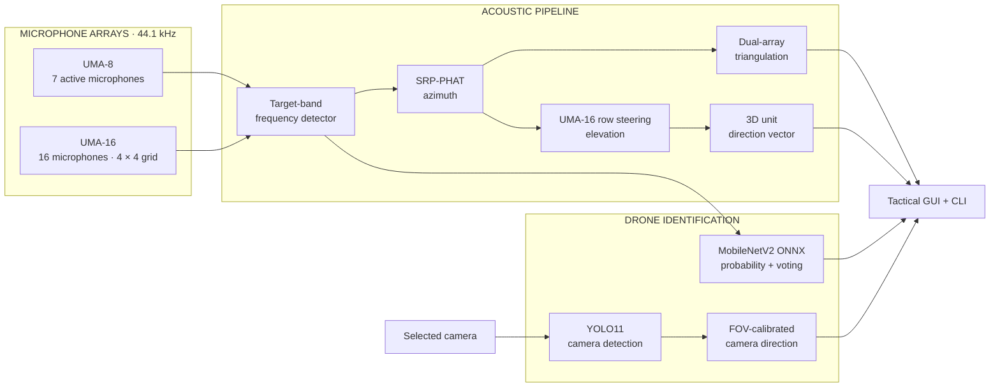

# FREQUENCY ID

### Multimodal Drone Detection, Acoustic Localization & 3D Sound Direction

Real-time drone awareness using microphone arrays, MobileNetV2 audio classification,
and YOLO camera detection—presented together in a tactical GUI and a headless CLI.


---

## Why Frequency ID?

| Capability | What it provides |
|---|---|
| **Frequency detection** | Narrowband FFT detection inside a configurable target band |
| **Acoustic direction** | Frequency-gated SRP-PHAT azimuth with temporal confidence tracking |
| **3D sound direction** | UMA-16 row-based elevation and a clear 3D unit-vector arrow |
| **2D localization** | Weighted bearing-ray intersection for dual-array position and range |
| **Audio identification** | MobileNetV2 ONNX drone probability with temporal voting |
| **Camera identification** | Selectable-camera YOLO detection with boxes, confidence, and direction |
| **Operator interface** | Tactical map, live spectrum, camera preview, 3D direction, and organized settings |

Audio and vision remain **independent evidence channels**. Camera detection does not
invent acoustic coordinates, and acoustic tracking continues if the camera is unavailable.

## Processing Pipeline



## Hardware

- **Front / Apex:** miniDSP UMA-8, seven active microphones, facing rig forward (`0°`).
- **Left flank:** miniDSP UMA-16 v2, 16 microphones on a 42 mm grid, facing left (`270°`).
- **Board separation:** 36.5 cm between XMOS boards.
- **Camera:** any OpenCV-compatible camera selected by the operator.

```text
                         UMA-8 APEX
                         Forward · 0°
                              /
                             /  36.5 cm
                            /
                  UMA-16 LEFT
                  Left · 270°
                  Black USB cable
```

The measured separation refers to the XMOS boards. The configurable
`mic_center_offset_local_m` translates the UMA-16 board reference to its acoustic
center and currently defaults to zero until physically measured.

Both arrays use vertical mounting. For a vertical array, `orientation_deg` is the
outward face normal, local `+90°` is the viewer's right, and azimuth scans are limited
to ±90° around that normal because of front/back ambiguity. Weak UMA-16 channels can
be excluded with `active_channels`.

## Quick Start

### 1. Install dependencies

Python dependencies:

```bash
python3 -m pip install -r requirements.txt
```

Tkinter is supplied by the system Python. On Debian/Ubuntu, if it is missing:

```bash
sudo apt install python3-tk
```

### 2. Check connected hardware

```bash
python3 main.py list-devices
python3 main.py list-cameras
```

Enter the displayed microphone IDs in **Settings → Audio & Detection**. Select the
camera in **Settings → Camera**; no camera index is permanently assumed.

### 3. Launch

```bash
# Full tactical GUI
python3 main.py gui

# GUI with simulated acoustic input
python3 main.py gui --simulate

# Headless terminal tracker
python3 main.py cli --low 900 --high 1100 --threshold -65
```

## Operating Modes

| Mode | GUI command | Output |
|---|---|---|
| **Dual array** | `python3 main.py gui` | Bearing, X/Y position, range, and audio classification |
| **UMA-8 only** | `python3 main.py gui --uma8-only` | Direction only |
| **UMA-16 only** | `python3 main.py gui --uma16-only` | Azimuth and elevation; 3D direction arrow |
| **UMA-16 front only** | `python3 main.py gui --uma16-front-only` | Forward-mounted 3D direction using the UMA-16 device ID |
| **Simulation** | Add `--simulate` | Synthetic acoustic input without microphone hardware |

In UMA-16 direction-only modes, the existing azimuth estimate is preserved and a
second narrowband SRP-PHAT stage uses the four physical microphone rows to estimate
elevation. No triangulation, source distance, source height, coordinates, or fixed Z
value is used.

The 3D arrow points **toward the sound source**. Positive elevation means above the
array; negative elevation means below. If the vertical estimate lacks prominence or
temporal consistency, the interface reports **ELEVATION UNCERTAIN** and draws no arrow
instead of assuming the source is level.

## GUI Guide

The interface is organized into four working areas:

- **Telemetry:** frequency, signal level, audio classification, camera state, bearing,
  elevation, range, and coordinates where available.
- **Visual analysis:** target-band spectrum, tactical map, annotated camera image,
  and a high-contrast 3D sound-direction view.
- **Actions:** Start Listening, classifier state, and map zoom.
- **Settings:** dedicated Audio & Detection, Camera, and Modes & Lock panels.

### Audio & Detection

Configure microphone IDs, band limits, detection threshold, and block averaging.
**Apply Audio** saves the settings to `rig_config.json`.

The MobileNetV2 tile reports probability and voting only when the frequency detector
finds a target-band signal. With no such signal, it shows **NO TARGET SIGNAL** and
clears stale voting history.

Enable **Require Drone ID for Lock** to gate acoustic target-lock status on confirmed
audio classification. Direction and coordinates remain visible while awaiting ID.

### Camera

Select any listed index or device path, then choose **Refresh Cameras** after hardware
changes. A stable `/dev/v4l/by-id/...` path is preferred because numeric indices can
change after reconnecting.

The YOLO worker runs in the background and keeps only the latest frame. A confirmed
visual target requires three consistent detections; isolated box jumps are rejected.

### Modes & Lock

Switch between dual-array, UMA-8-only, UMA-16-only, and forward-mounted UMA-16 modes.
Changing modes while listening restarts only the required audio streams and restores
normal left-array geometry when leaving front-only mode.

## Camera Direction Calibration

**No field of view is assumed.** YOLO detection works without calibration, but camera
bearing and elevation remain **UNCALIBRATED** until a valid horizontal FOV is supplied.

1. Select the camera.
2. Enter its measured horizontal FOV in **Horizontal FOV (°)**.
3. Click **Apply FOV**.
4. Repeat for each camera or lens.

FOV values must be greater than `0°` and less than `180°`. Values are stored separately
in `vision.camera_fovs`, preventing one camera's calibration from being silently reused
for another. `vision.orientation_deg` rotates local camera bearing into the rig frame.

To measure FOV, place a small object at known left and right angles and adjust HFOV
until the reported local bearings match. Manufacturer specifications are useful starting
points, but measured values are preferred.

A confirmed camera target displays confidence, global bearing, elevation, and a dashed
purple direction ray. It never creates a camera-based distance, position, or acoustic lock.

## Command Reference

### GUI

```bash
# Custom audio model or no audio classifier
python3 main.py gui --model /path/to/mobilenetv2_drone.onnx
python3 main.py gui --no-classifier

# Camera selection and direction calibration
python3 main.py gui --camera 0
python3 main.py gui --camera /dev/v4l/by-id/your-camera-path
python3 main.py gui --camera 0 --camera-fov 75

# Custom YOLO checkpoint or no vision
python3 main.py gui --yolo-model /path/to/best.pt
python3 main.py gui --no-vision

# Require confirmed audio drone ID for an acoustic lock
python3 main.py gui --require-drone
```

### CLI

```bash
# Audio and calibrated camera telemetry
python3 main.py cli --camera 0 --camera-fov 75 --low 900 --high 1100

# UMA-16 3D direction, with no localization
python3 main.py cli --uma16-front-only --low 900 --high 1100

# Audio-only acoustic tracking
python3 main.py cli --no-classifier --no-vision --low 900 --high 1100

# Strict acoustic lock in simulation
python3 main.py cli --simulate --require-drone --low 900 --high 1100
```

## Coordinate Conventions

```text
                 +Y · FORWARD · 0°
                         ^
                         |
                         |
       LEFT · 270°  <----o---->  +X · RIGHT · 90°
                         |
                         |
                       REAR · 180°

                 +Z · UP · positive elevation
```

- Bearing increases clockwise from rig forward.
- Elevation is positive above the array or camera horizon.
- Acoustic 3D vectors are unit directions, not positions.
- Dual-array coordinates and range are expressed in meters.

## Verification

```bash
# Complete automated suite: audio, geometry, elevation, and vision
python3 -m unittest test_classifier test_vertical_uma16 test_vision

# Physical rig geometry checks
python3 main.py test-geometry

# Offline classification and triangulation benchmark
python3 main.py simulate --target-x -0.6 --target-y 1.5
```

For physical validation, play a target-band tone to the left, right, above, and below
the installed UMA-16. Confirm both angle signs and arrow directions. Real elevation
accuracy depends on frequency, microphone matching, signal-to-noise ratio, mounting,
and room reflections; synthetic validation does not replace this hardware check.

## Troubleshooting

| Symptom | What to check |
|---|---|
| `WAITING FOR AUDIO INPUT` | Microphone IDs, USB connections, and selected array mode |
| `NO TARGET SIGNAL` | Target band, threshold, source level, and whether the tone is present |
| `ELEVATION UNCERTAIN` | Signal quality, reflections, vertical prominence, and temporal stability |
| `DOA BLOCKED` | Target frequency exceeds the array's safe spatial-aliasing limit |
| Camera `OFFLINE` | Camera path, permissions, another process using the device, or USB connection |
| `DIRECTION UNCALIBRATED` | Enter a valid horizontal FOV for the selected camera |
| Classification stays idle | Audio classification is intentionally gated by target-band detection |

## Project Structure

| File | Responsibility |
|---|---|
| [`main.py`](main.py) | CLI/GUI launcher, arguments, model setup, and device listing |
| [`audio_manager.py`](audio_manager.py) | Multi-device capture and synthetic wavefield simulation |
| [`detector.py`](detector.py) | Target-band FFT detection and peak estimation |
| [`doa_engine.py`](doa_engine.py) | Azimuth, UMA-16 elevation, confidence tracking, and 3D vectors |
| [`geometry.py`](geometry.py) | Array geometry and local/global coordinate transforms |
| [`triangulation.py`](triangulation.py) | Weighted dual-array position and range estimation |
| [`classifier.py`](classifier.py) | MobileNetV2 ONNX inference, resampling, and temporal voting |
| [`vision_detector.py`](vision_detector.py) | Camera selection, background YOLO inference, and visual direction |
| [`tactical_gui.py`](tactical_gui.py) | Telemetry, radar, camera preview, 3D arrow, and organized settings |
| [`rig_config.json`](rig_config.json) | Hardware geometry, detection, model, and camera configuration |
| [`model/`](model/) | MobileNetV2 ONNX assets and YOLO `best.pt` checkpoint |
| [`test_classifier.py`](test_classifier.py) | ONNX parity, resampling, voting, and acoustic integration tests |
| [`test_vertical_uma16.py`](test_vertical_uma16.py) | Geometry, azimuth, elevation, and direction-vector regressions |
| [`test_vision.py`](test_vision.py) | Vision filtering, target lock, direction, retry, and shutdown tests |

---

**Frequency ID** — hear the direction, identify the source, and see the evidence.
