# Frequency ID: Visual Detection & Tracking Workflow

This document provides a comprehensive end-to-end breakdown of the visual detection and tracking pipeline in **Frequency ID**, showing how raw camera frames transition into semantic drone detections, high-rate visual tracking, calibrated 3D direction rays, and tactical telemetry.

---

## 1. High-Level Architecture Overview

The visual subsystem uses an **asynchronous, dual-rate hybrid architecture**:
1. **DyHiT (Hierarchical Transformer)**: Runs synchronously on **every camera frame** at high frame rate (~30+ FPS, low latency) to track the drone’s precise bounding box between detector updates.
2. **YOLO11**: Runs asynchronously in a background worker thread on a dedicated CUDA stream to periodically verify the tracker, correct drift, detect new targets, or reacquire lost targets.
3. **TargetLogic State Machine**: Matches delayed YOLO detections to their exact historical source frames, evaluates spatial overlap (IoU) and distance gates, and commands tracker corrections or catch-up.
4. **Direction Projection Engine**: Converts 2D pixel coordinates into calibrated 3D angles (global bearing and elevation) using the camera's measured Horizontal Field of View (HFOV).

```mermaid
sequenceDiagram
    autonumber
    participant Cam as OpenCV Camera
    participant TrackThread as Tracker Thread (Main)
    participant Core as TrackerCore & Ring Buffer
    participant Queue as LatestRequestQueue (maxsize=1)
    participant YoloThread as YOLO Verifier Thread (Async)
    participant Logic as TargetLogic State Machine
    participant Direction as Pixel-to-Direction Engine
    participant UI as Tactical GUI / CLI

    Cam->>TrackThread: Read frame (BGR uint8, timestamp T)
    TrackThread->>Core: pre_image(T): Should frame go to YOLO?
    alt In SEARCH mode or every N-th frame (default: 5)
        Core-->>TrackThread: send = True
        TrackThread->>Queue: put(frame, T) [drops stale frame if busy]
    else Tracking between checks
        Core-->>TrackThread: send = False
    end

    TrackThread->>Core: on_image(frame, T): DyHiT update(frame)
    Core->>Core: Store (T, frame, box, score) in ring buffer (len=60)
    Core-->>TrackThread: Tracked FrameResult(box, mode)

    rect rgb(35, 45, 60)
    Note over Queue,YoloThread: Asynchronous YOLO Worker Loop (CUDA Stream)
    Queue->>YoloThread: get() -> (frame, T_det)
    YoloThread->>YoloThread: YOLO11 inference (filter class == 'drone')
    YoloThread->>Core: on_detections(dets, T_det)
    Core->>Core: Lookup historical frame at T_det in ring buffer
    Core->>Logic: check(box@T_det, dets@T_det) or search(dets@T_det)
    Logic-->>Core: Decision (confirm / correct / reacquire / lost)
    opt Tracker needs restart / correction
        Core->>Core: Re-init DyHiT on detection box at T_det
        Core->>Core: Bounded catch-up (up to 3 frames to present)
    end
    end

    TrackThread->>Direction: pixel_to_direction(box_center, HFOV, orientation)
    Direction-->>TrackThread: CameraDirection (bearing, elevation, 3D ray)
    TrackThread->>UI: VisionResult (annotated frame, direction, telemetry)
```



---

## 2. Step-by-Step Pipeline Breakdown

### Step 1: Video Capture & Ingestion
- **Files**: `vision_detector.py` and `tracked_camera.py`
- Accepts standard V4L2 device indices (`0`, `1`), stable udev paths (`/dev/v4l/by-id/...`), or network RTSP streams (`rtsp://...`).
- When a new frame arrives via `cv2.VideoCapture.read()`, the tracker thread stamps it with a high-resolution monotonic timestamp `stamp = time.monotonic()`.

### Step 2: Verification Gating & Non-Blocking Request Queue
- **Files**: `visual_tracking/core.py` and `tracked_camera.py`
- Before the tracker processes the image, `TrackerCore.pre_image(stamp)` decides if YOLO needs to inspect this frame:
  - **In `SEARCH` mode**: Returns `True` on every frame (to detect and acquire a drone as quickly as possible).
  - **In `TRACK` mode**: Returns `True` every $N$-th frame (configured by `detector_every`, default: `5` frames).
- If `True`, the frame and timestamp are posted to `LatestRequestQueue`:
  - **Zero Backlog / No Latency Accumulation**: `LatestRequestQueue` has `maxsize=1`. If YOLO is still computing an earlier frame, the old unread request is immediately discarded in favor of the latest frame.

### Step 3: Fast Synchronous Visual Tracking (DyHiT)
- **Files**: `tracked_camera.py` and `visual_tracking/core.py`
- If the tracker is initialized and active (`self.ready == True`):
  - Calls `tracker.update(frame)` using the vendored **DyHiT transformer** model (`visual_tracking/tracker_lib/trackers/dyhit/models/DyHiT_ep0060.pth.tar`).
  - DyHiT predicts target bounding box `(x, y, w, h)` and a tracking confidence score in ~14–33 ms.
- The frame, computed box, confidence score, and timestamp are saved in a 60-frame historical ring buffer `buf`.

### Step 4: Asynchronous YOLO11 Semantic Verification
- **Files**: `tracked_camera.py` and `vision_detector.py`
- The background verifier thread consumes from `LatestRequestQueue`:
  1. Runs `YOLO.predict(frame, conf=0.5)` on its own CUDA stream (`torch.cuda.Stream()`), completely isolating YOLO execution from the DyHiT tracker.
  2. Filters detected class labels: only objects labeled `"drone"` are accepted; birds, cars, or background clutter are discarded.
  3. Formats predictions into `logic.Detection` instances `(box, score, label)`.
  4. Calls `TrackerCore.on_detections(detections, stamp)`.

```mermaid
stateDiagram-v2
    [*] --> SEARCH

    state SEARCH {
        [*] --> SearchingForTarget
        SearchingForTarget --> InitTarget : Detection found (first time)
        SearchingForTarget --> ReacquireTarget : Detection matches near tracker/history
    }

    state TRACK {
        [*] --> TrackingActive
        TrackingActive --> Confirm : YOLO box overlaps DyHiT (IoU >= 0.3)
        TrackingActive --> Correct : YOLO box near target; DyHiT re-initialized
        TrackingActive --> SwitchPrevention : YOLO jumped to another object; re-centered
        TrackingActive --> Unverified : No YOLO detection nearby; DyHiT continues
    }

    InitTarget --> TRACK : Decision: "init"
    ReacquireTarget --> TRACK : Decision: "reacquire"
    Unverified --> SEARCH : Target unseen > lost_after_s (0.5 s) (Decision: "lost")
```

### Step 5: Historical Time-Alignment & Decision State Machine
- **File**: `visual_tracking/logic.py`
- Because YOLO takes tens of milliseconds to run, its results arrive when the live camera feed has already advanced several frames.
- **Historical Frame Matching**: `TrackerCore._find(stamp)` matches YOLO's timestamp to the exact historical frame stored in the 60-frame ring buffer. The YOLO bounding boxes are compared against what DyHiT saw on **that specific past frame**, not the current live frame.
- The `TargetLogic` state machine computes the event:

| Event | Conditions | System Action |
|---|---|---|
| **`init`** | State was `SEARCH` (no prior target); YOLO detects a drone. | Initializes DyHiT on the best detection box; transitions state to `TRACK`. |
| **`confirm`** | State is `TRACK`; YOLO detection overlaps DyHiT box ($\text{IoU} \ge 0.3$) and passes distance limits. | Confirms target identity; resets miss counter and loss timers. |
| **`correct`** | State is `TRACK`; DyHiT drifted, but a YOLO drone detection is near the target's last confirmed position ($\le 1.5 \times \text{target size}$). | Restarts DyHiT on the corrected detection box; triggers bounded catch-up. |
| **`switch`** | A detection overlaps DyHiT, but is far from the true target or another detection is much closer to the last known position. | Prevents tracker from hijacking onto false targets / other drones. |
| **`unverified`** | State is `TRACK`; no YOLO detection matches near the target. | DyHiT continues autonomously; increments miss counter. |
| **`reacquire`** | State was `SEARCH`; a drone appears near the still-running DyHiT box or within the expanding search radius ($200\text{ px/s}$). | Re-locks target; transitions state back to `TRACK`. |
| **`lost`** | Target unverified for $\ge 0.5\text{ s}$ (`lost_after_s`). | Transitions state to `SEARCH`; clears target box and direction vectors. |

### Step 6: Bounded Tracker Catch-Up
- **File**: `visual_tracking/core.py`
- If DyHiT was restarted or corrected on a historical frame, it is now slightly behind real time.
- `TrackerCore` quickly iterates through the subsequent buffered frames (up to `max_catch_up = 3` frames) running `tracker.update(frame)` to catch up to the current frame.
- If the lag exceeds 3 frames, catch-up is skipped and tracking resumes directly on the next incoming live frame, strictly bounding processing latency.

### Step 7: Pixel-to-Direction 3D Projection
- **File**: `vision_detector.py`
- Once the target box `(x1, y1, x2, y2)` is confirmed on the current frame, its optical center $(u, v)$ is calculated:
  $$u = \frac{x_1 + x_2}{2}, \quad v = \frac{y_1 + y_2}{2}$$
- **Horizontal FOV Gating**: If no measured HFOV is configured in `rig_config.json`, the angles remain `DIRECTION UNCALIBRATED` to prevent false telemetry.
- When a valid horizontal FOV ($\theta_{\text{hfov}}$) is supplied:
  1. Virtual focal length:
     $$f_x = \frac{\text{width}}{2 \tan(\theta_{\text{hfov}} / 2)}$$
  2. Optical offsets relative to principal center $(c_x, c_y)$:
     $$\text{right} = \frac{u - c_x}{f_x}, \quad \text{up} = -\frac{v - c_y}{f_x}$$
  3. Local angles:
     $$\text{bearing}_{\text{local}} = \arctan(\text{right}), \quad \text{elevation} = \arctan2\left(\text{up}, \sqrt{1 + \text{right}^2}\right)$$
  4. Global Rig Bearing:
     $$\text{bearing}_{\text{global}} = (\text{bearing}_{\text{local}} + \text{orientation}_{\text{camera}}) \pmod{360^\circ}$$
  5. 3D Unit Vector Ray:
     $$\vec{r} = \left(\frac{\text{right}}{\|\vec{v}\|}, \frac{\text{up}}{\|\vec{v}\|}, \frac{1}{\|\vec{v}\|}\right)$$

### Step 8: Tactical GUI & Operator Overlays
- **Files**: `tactical_gui.py` and `tracked_camera.py`
- **Camera Video Canvas**:
  - The followed drone is drawn in **Red** (`#4444ff` BGR): labeled `DRONE TRACKING | LAST YOLO 95% | 348.2 deg`.
  - Secondary / unconfirmed candidate detections are drawn in **Blue/Amber**: labeled `YOLO 88%`.
- **Tactical Radar Map**:
  - A purple dashed ray is cast from the rig origin along `bearing_global`, showing the optical line-of-sight intersecting with the acoustic bearing rays.
- **Top Telemetry Card**:
  - Displays real-time camera state: `Camera: DRONE TRACKING | Bearing: 348.2° | Elevation: +4.1°`.

---

## 3. Standalone YOLO-Only Fallback (`--no-tracker`)

If visual tracking is disabled (via `--no-tracker`), the system switches to the standalone `DroneCamera` pipeline in `vision_detector.py`:
- Evaluates YOLO detections on every camera frame.
- Uses `DetectionLock` with a 120-pixel spatial gate.
- Requires **3 consecutive frames** with matching bounding boxes before promoting the target from `ACQUIRING` to locked `DRONE`.
